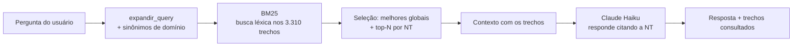

# 🔥 Mr. Incêndio

**Consulta inteligente às Normas Técnicas do Corpo de Bombeiros do RJ (CBMERJ) com IA.**

Projetistas e engenheiros perdem horas abrindo PDFs de 200+ páginas para achar uma
exigência de segurança contra incêndio. O Mr. Incêndio responde em segundos, em
português natural, **citando a NT e o item** — buscando apenas nas normas oficiais do CBMERJ.


---

## ✨ O que faz

- 💬 **Chat técnico** sobre as NTs do CBMERJ (grupos 1 a 5 + COSCIP) — **3.310 trechos** de **53 normas** indexadas.
- 🎯 **Respostas com citação** da NT e do item, prontas para o projeto.
- 📄 Mostra os **trechos consultados** que embasaram cada resposta (transparência / anti-alucinação).
- 👤 **Contas** pessoais e **empresariais** (pool de créditos compartilhado, consumo por colaborador).
- 💳 **Créditos** sem validade, com pagamento via **PIX e cartão** (Pagar.me).
- 🏆 **Gamificação** — pontos e badges por uso.

> ⚠️ Ferramenta de apoio, de caráter informativo. Não substitui o profissional habilitado nem a aprovação formal junto ao CBMERJ.

---

## 📸 Capturas de tela

| Landing | Chat |
|---|---|
|  |  |

> As imagens ficam em `docs/`. (Rode o app e salve os prints com esses nomes para aparecerem aqui.)

---

## 🧠 Como o RAG funciona

O sistema usa **RAG (Retrieval-Augmented Generation)**: em vez de perguntar "de cabeça"
para a IA, ele primeiro **busca os trechos certos das normas** e só então pede para o
modelo responder com base neles. Isso mantém a resposta ancorada na norma oficial.



**Pipeline de dados (offline):**

```
baixar_normas.py   → baixa os PDFs oficiais do CBMERJ  → dados/indice.json
indexar.py         → extrai texto (pdfplumber), quebra em trechos,
                     treina o BM25                      → dados/chunks.pkl, dados/bm25.pkl
```

**Em tempo de consulta** (`rag.py`):

1. `expandir_query` normaliza acentos e injeta **sinônimos do domínio**
   (ex: *sprinkler* → *chuveiro, automático, aspersão*), melhorando o recall.
2. `BM25` pontua os 3.310 trechos por relevância léxica.
3. A seleção combina os **melhores trechos globais** com os **melhores de cada NT**
   relevante — assim uma norma inteira não é descartada por causa de um único trecho dominante.
4. `montar_contexto` formata os trechos e o **Claude Haiku** responde citando a NT.

A busca é 100% local e determinística (sem embeddings/API para recuperar) — rápida, barata e testável.

---

## 🛠️ Stack

| Camada | Tecnologia |
|---|---|
| Interface | **Streamlit** (multipage) |
| LLM | **Claude Haiku** (Anthropic API) |
| Recuperação | **BM25** (`rank-bm25`) + expansão por sinônimos |
| Extração de PDF | **pdfplumber** |
| Banco de dados | **SQLite** (usuários, créditos, transações, conversas, auditoria) |
| Autenticação | **bcrypt** + tokens de sessão + rate limiting |
| Pagamentos | **Pagar.me** (PIX e cartão) |
| Testes / CI | **pytest** + **GitHub Actions** |

---

## 🚀 Como rodar

### Pré-requisitos
- Python 3.12+
- Uma chave da API da Anthropic

### Instalação

```bash
git clone https://github.com/betocointv/mr-incendio.git
cd mr-incendio
pip install -r requirements.txt
```

### Configuração dos segredos

Crie `.streamlit/secrets.toml` (já está no `.gitignore`):

```toml
ANTHROPIC_API_KEY   = "sua-chave-aqui"
ADMIN_PASSWORD_HASH = "gere-com-o-script-abaixo"
# Opcionais (pagamentos):
# PAGARME_SECRET_KEY = "..."
```

Gere o hash da senha do admin (a senha nunca é salva em texto puro):

```bash
python gerar_hash_admin.py
```

### (Opcional) Reconstruir o índice das normas

O índice (`dados/chunks.pkl`, `dados/bm25.pkl`) já vem pronto no repositório.
Para reconstruir a partir dos PDFs:

```bash
python baixar_normas.py   # baixa os PDFs oficiais do CBMERJ
python indexar.py         # extrai, fragmenta e treina o BM25
```

### Subir o app

```bash
streamlit run app.py
```

---

## 🧪 Testes

```bash
pip install -r requirements-dev.txt
pytest
```

- **`tests/test_rag.py`** — teste de referência com **15 perguntas reais**: verifica se a
  busca recupera a **NT correta** (ex: "extintores" → NT 2-01) **sem chamar a IA**.
  É um teste de *recall*, rápido e gratuito.
- **`tests/test_auth.py`** — validações de e-mail, senha, CPF, CNPJ e hash bcrypt.
- **`tests/test_creditos.py`** — progressão de pontos e badges.

A cada `push` e `pull request`, o **GitHub Actions** roda toda a suíte
(`.github/workflows/tests.yml`).

---

## 📁 Estrutura

```
app.py                 Landing page
pages/                 Telas (Chat, Planos, Pagamento, Admin, Empresa, ...)
rag.py                 Núcleo de busca (BM25 + sinônimos) — puro e testável
auth.py                Autenticação (bcrypt, sessão, rate limit)
db.py                  Camada SQLite
creditos.py            Créditos, pontos e badges
pagamento.py           Integração Pagar.me (PIX / cartão)
indexar.py             Pipeline de indexação (PDF → BM25)
baixar_normas.py       Download dos PDFs oficiais
tests/                 Suíte pytest
```

---

## 🗺️ Roadmap

- [ ] Webhook do Pagar.me (hoje a confirmação é por verificação ativa)
- [ ] Expansão para outros estados (SP, MG, ES)
- [ ] Busca híbrida (BM25 + embeddings)

---

Feito por [@betocointv](https://github.com/betocointv) · © 2026
